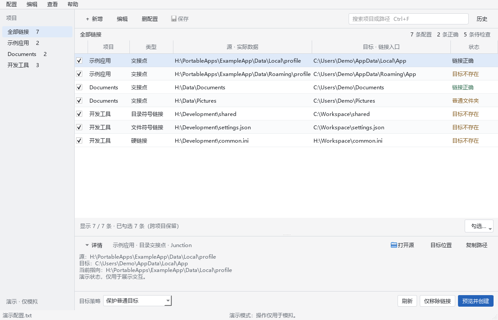
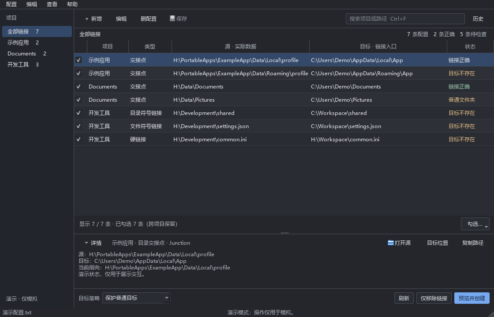

# Windows Link Manager

一个紧凑的 Windows 桌面链接管理器，用来按项目管理 Junction、符号链接与硬链接。操作前展示计划，提供普通目标保护、备份后替换、操作历史及可恢复记录的撤销。

A compact Windows desktop manager for junctions, symbolic links and hard links, with operation previews, target protection and recovery history.



## 下载与启动

普通用户需要 **Windows 10（1809 或更新版本）/Windows 11 x64**。从 [Releases](https://github.com/yuri368/windows-link-manager/releases/latest) 选择一种下载即可：

| 下载 | 如何打开 |
| --- | --- |
| `windows-link-manager-版本-windows-x64-setup.exe`（推荐） | 双击安装，完成后从开始菜单打开 Windows Link Manager。安装在当前用户目录，无需管理员权限。 |
| `windows-link-manager-版本-windows-x64.zip`（便携版） | 解压到可写目录，双击 `WindowsLinkManager.exe`。请保留同目录的 `_internal` 文件夹。 |

安装版和便携版均包含所需的 Python 运行环境和 Qt 库，**不用另装 Python，不用运行命令，也不用联网安装依赖**。第一次打开显示可编辑的空列表，通过“新增”填写链接并保存即可。

配置保存在程序目录的 `软链接.txt`，操作历史在 `.state` 中。安装版升级前请保留这些文件；卸载器仅移除安装的程序文件，用户自行创建的配置和历史保留。便携版迁移时，请复制整个程序目录。

### 从源码运行

源码 ZIP 和克隆的仓库面向开发者，需要 **64 位 Python 3.11–3.14**，依赖固定为 `PySide6==6.11.2`。双击 `启动.vbs` 或 `启动.cmd`；首次启动创建独立的 `.venv` 并联网安装依赖，日志在 `.state/launcher.log`。

源码版双击 `演示.cmd` 可以先体验界面；二进制版可运行 `WindowsLinkManager.exe --demo`。演示模式在内存中模拟链接操作；显式导出配置仍会保存到所选择的文件。

## 使用

- 项目侧栏、搜索、可调整列宽的单行列表和可折叠详情区。
- 新增、编辑、删除配置记录；批量选择、检查、操作预览、配置导入和导出。
- 四种链接类型：目录联接点（Junction）、目录符号链接、文件符号链接、硬链接。
- 操作历史、可恢复创建记录的撤销、未完成操作的恢复预检。
- 跟随系统的浅色/深色外观，并支持高对比度显示。

快捷键：`Ctrl+F` 搜索，`Ctrl+N` 新增，`Ctrl+E` 编辑，`Ctrl+S` 保存，`F5` 刷新。正式窗口使用单实例锁，演示窗口可独立运行。



## 目标策略与恢复

保存配置只保存记录。点击“预览并创建”并确认后，程序才会修改链接。

| 目标策略 | 行为 |
| --- | --- |
| 保护普通目标（默认） | 拒绝覆盖已有普通文件或目录。 |
| 备份后替换 | 将普通目标移动到同目录备份位置，再创建链接；计划和历史显示备份路径。失败时尝试回滚。 |
| 永久删除后创建 | 删除普通目标中的数据再创建链接，需要额外确认。数据不进入回收站，没有备份，无法撤销；后续创建失败也无法恢复已经删除的数据。 |

“仅移除链接”只删除链接入口，保留源数据。目标内部的链接也只移除入口，不跟随删除它所指向的数据。

撤销和恢复会核对入口及备份的身份。程序仅自动恢复能够确认且可逆的创建记录；永久删除、移除记录和状态不明的记录需按历史说明人工核对。恢复回到执行前状态，不会续跑创建或永久删除任务。外部修改或权限问题导致无法完整回滚时，会显示错误和剩余状态。

符号链接需要 Windows 开发者模式或相应权限。程序不会自动开启开发者模式或强制提权。硬链接要求源和目标位于同一卷。程序会检查路径循环、目标重叠、源缺失、重解析父路径，以及覆盖程序或状态目录的操作。

## 配置格式

使用 UTF-8 文本，项目标题为 `【项目名称】`，路径按**源、目标**成对排列；空行与整行 `#` 注释可用于整理配置。默认链接类型为 Junction。

```text
【示例项目】
H:\ExampleData\Documents
C:\ExampleWorkspace\Documents

# @type=file_symlink
H:\ExampleData\settings.json
C:\ExampleWorkspace\settings.json
```

`# @type=` 只影响下一对路径，可选 `junction`、`dir_symlink`、`file_symlink`、`hardlink`。路径必须是本机绝对路径，可以带外层双引号；运行时展开 `%USERNAME%` 等环境变量，原始配置保留变量写法。

[配置模板](examples/软链接.example.txt)中的路径已注释，按实际位置填写后再导入。原始配置编辑保留注释；表格编辑按统一格式重新生成文本。保存已有配置时，旧文本备份在配置旁的 `.backups` 中。操作历史保存在程序目录的 `.state` 中，迁移程序时应一并保留。

## 命令行与开发

手动安装并运行：

```powershell
python -m venv .venv
.\.venv\Scripts\python.exe -m pip install -r requirements.txt
.\.venv\Scripts\python.exe -m linkmanager
.\.venv\Scripts\python.exe -m linkmanager --demo
.\.venv\Scripts\python.exe -m linkmanager --check --config "C:\ExampleWorkspace\links.txt"
.\.venv\Scripts\python.exe -m linkmanager --version
```

`--check` 只检查配置语法，不检查路径是否存在或执行链接操作。启动器也接受 `--demo`、`--check`、`--config PATH` 和 `--screenshot PATH`；截图参数仅用于演示模式。

也可使用 `pip install .` 安装包，以 `windows-link-manager` 或 `windows-link-manager-cli` 启动。安装包使用 `%LOCALAPPDATA%\WindowsLinkManager` 保存配置和状态；源码目录保持便携数据布局。

在 Windows 上运行测试与构建源码包：

```powershell
$env:QT_QPA_PLATFORM = "offscreen"
.\.venv\Scripts\python.exe -m unittest discover -s tests -v
.\.venv\Scripts\python.exe scripts/build_release.py
```

构建 Windows 发行版（64 位 Windows，Inno Setup 6 用于生成安装器）：

```powershell
.\.venv\Scripts\python.exe -m pip install PyInstaller==6.22.3
.\.venv\Scripts\python.exe scripts/collect_dependency_sources.py
.\.venv\Scripts\python.exe scripts/build_windows.py
```

`packaging/windows-link-manager.iss` 定义当前用户安装及快捷方式。Release 工作流会实际安装到临时目录并运行打包后的 GUI，测试通过后发布安装器、便携包、项目源码和对应版本的 Qt/PySide 源码附件。依赖源码附件用于开源授权履行和重建，普通用户无需下载。

测试中的文件操作使用 TEMP 隔离目录，GUI 测试使用离屏模式。缺少符号链接权限时，对应真实符号链接子项会跳过。Windows CI 验证 Python 3.11 和 3.13；标记版本的 Release 工作流先运行测试，再发布源码 ZIP。

核心职责分别位于 `config`（配置）、`paths`（路径边界）、`planning`（批次计划）、`windows_backend`（Windows 链接）、`core`（事务执行）、`history`（历史）、`runtime`（数据位置）；界面通过服务接口调用这些模块。

## 许可证与开发说明

项目代码采用 **GPL-3.0-only**，完整条款见 [LICENSE](LICENSE)。第三方依赖保留其自身许可证，详情见 [THIRD_PARTY_NOTICES.md](THIRD_PARTY_NOTICES.md)。界面使用本机系统字体，仓库不再分发微软字体。

本项目使用 OpenAI Codex 辅助实现、重构与测试；维护者负责需求、功能取舍与发布决策。AI 辅助开发不代表第三方代码的授权义务可以被省略。发现具体的来源或许可问题时，请通过 Issues 提供文件位置及来源。
